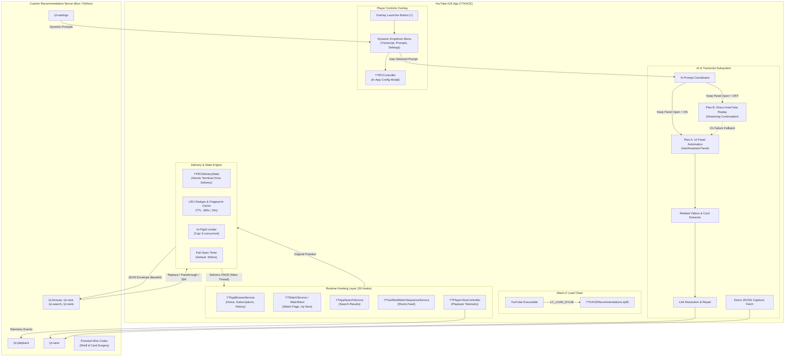
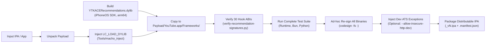
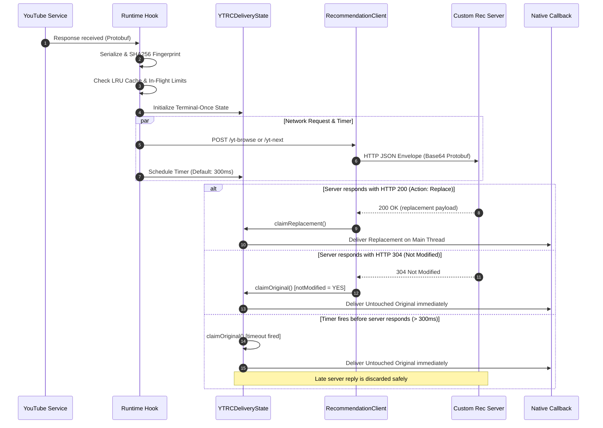
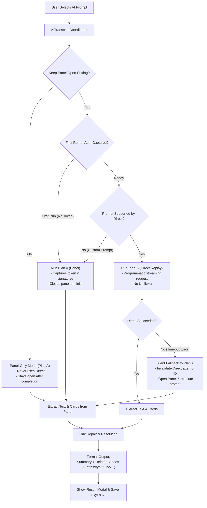
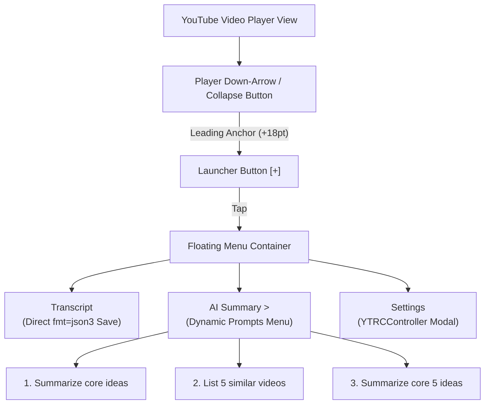
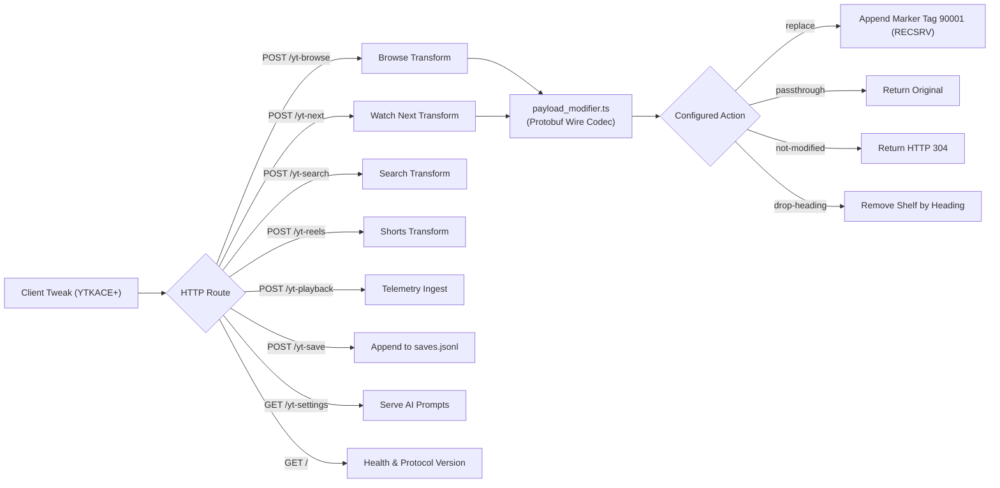

# YTKACE+ Overall System Architecture

This document describes the end-to-end architecture of **YTKACE+ Recommendations & AI Transcript Patch** (`YTKACERecommendations.dylib`), including its binary injection mechanism, fail-open runtime hooks, recommendation transformation pipeline, dual-path AI summary engine, player UI overlays, and backend transform server.

---

## 1. Architectural Principles & Philosophy

1. **Non-Invasive & Decoupled**: The patch operates as a self-contained, additive dynamic library (`YTKACERecommendations.dylib`). It requires no YouTube or YTKACE source code, no Theos build system, and leaves all original application binaries and resources byte-preserved.
2. **Fail-Open by Design**: YouTube is a fast-moving, closed-source consumer app. Network stalls, schema mismatches, parse errors, or missing hooks must **never** degrade the user experience or crash the app. Any server timeout, HTTP error, protocol mismatch, or unhooked method immediately defaults to YouTube's native response or native UI.
3. **Authoritative Replacement**: What YouTube renders is governed strictly by the completion blocks of its data services. Delivering validated replacement protobuf payloads directly into these completion blocks ensures that rendering, caching, navigation, and playback operate normally with zero custom UI recreation.
4. **Isolated Transport & Single Coordinator**: Network routing, UI automation, and direct API replay are strictly decoupled. Executors never call each other recursively. A central coordinator manages attempts, cancellations, timeouts, and fallbacks.

---

## 2. High-Level Architecture



---

## 3. Binary Packaging & Injection Pipeline

The build and packaging toolchain integrates the patch into stock or pre-modified IPAs without recompiling the original app.



### Key Packaging Components
- **`Tools/macho_inject.c`**: Appends an `@rpath/YTKACERecommendations.dylib` `LC_LOAD_DYLIB` load command directly into the Mach-O header of the main `YouTube` binary.
- **`Scripts/package-recommendations.py`**: Manages directory extraction, framework staging, dylib insertion, and ad-hoc code signing. Preserves original hashes of YTKACE resources.
- **ATS Variants**:
  - `dist/YTKACE_<version>_Recommendations_vN.ipa`: Includes `NSAppTransportSecurity` exceptions to allow development over plain HTTP local network servers (`http://192.168.x.x`).
  - `dist/YTKACE_<version>_Recommendations_vN_clean.ipa`: Leaves `Info.plist` unmodified for production HTTPS deployment.
- **`Scripts/make.sh`**: One-shot orchestrator that compiles, validates, runs tests, auto-increments version numbers, and outputs the installable IPA.

---

## 4. Runtime Hooking System & ABI Verification

The patch utilizes 30 Objective-C runtime method swizzles installed at library initialization (`__attribute__((constructor)) YTRCStart`).

### Fail-Closed ABI Guarding
Before swizzling any method, `RecommendationRuntime.mm` executes `YTRCMethodMatches()`. This verifies that:
1. The target class exists in the Objective-C runtime.
2. The selector exists on that class.
3. The method's full type encoding matches the expected signature character-for-character (e.g., `v@:@B@@?@?@?`).

If a method signature differs (due to a YouTube version update or structural change), the hook **fails closed**: it skips installation, logs the mismatch, and leaves the native method untouched.

### Complete Hook Inventory

| # | Target Class & Selector | Signature | Responsibility |
|---|-------------------------|-----------|----------------|
| **1** | `YTAppBrowseService makeRequest:refresh:reloadContinuationData:initialResponseBlock:responseBlock:errorBlock:` | `v@:@B@@?@?@?` | Intercepts browse feeds (Home `FEwhat_to_watch`, Subscriptions `FEsubscriptions`, History `FEhistory`, etc.) |
| **2** | `YTAppBrowseService selectBrowseIDForRequestForBrowseID:andContinuation:` | `@@:@@` | Maps pagination continuation tokens back to parent browse surfaces |
| **3** | `YTAppBrowseService addBrowseIdToCacheIfRequiredForContinuationKey:browseID:` | `v@:@@` | Maintains lineage cache for browse continuation tokens |
| **4** | `YTInnerTubeFeedControllerDataSource requestContinuationWithType:initialResponseBlock:block:errorResponseBlock:` | `v@:Q@?@?@?` | Intercepts tabbed Home category chips (`[All]`, `[Podcasts]`, `[News]`) |
| **5-6** | `YTInnerTubeFeedControllerDataSource requestInnerTubeContinuationWithContinuationToken:…` (2 variants) | `v@:@Q@B@B@?@?` / `v@:@B@B@?@?` | Captures feed teaser prefetch continuations (`browse-teaser`) |
| **7-8** | `YTWatchService setWatchNextRequest:willMakeRequestBlock:completionBlock:` (and handler variant) | `v@:@@?@?` / `v@:@@?@?@?` | Primary watch page hook (player overlays, panels, related videos) |
| **9-11** | `YTAppWatchNextService makeRequest:refresh:responseBlock:errorBlock:` (+ timeout / fallback variants) | `v@:@B@?@?` / `v@:@Bd@?@?` | Intercepts related-video continuations on the watch page |
| **12-13** | `YTWatchNextServiceImpl makeRequest:refresh:responseBlock:errorBlock:` (+ timeout variant) | `v@:@B@?@?` / `v@:@B@?@?d` | Base implementation hooks for watch-next requests |
| **14** | `YTCompositeWatchNextService makeRequest:refresh:responseBlock:errorBlock:` | `v@:@B@?@?` | Coverage hook for composite watch-next service |
| **15-16** | `YTAppSearchService makeRequest:refresh:responseBlock:errorBlock:` / `YTSearchServiceImpl` | `v@:@B@?@?` | Intercepts search queries and result feeds |
| **17** | `YTSettingsViewController setSectionItems:forCategory:title:icon:titleDescription:headerHidden:` | `v@:@Q@@@B` | Injects the RECOMMENDATIONS SERVER section into native YTKACE settings |
| **18-19** | `YTGetReelWatchSequenceServiceImpl makeYTIReelWatchSequenceRequest:…` (2 variants) | `@@:@@?@?` / `@@:@B@?@?` | Intercepts vertical Shorts feed sequences (`/yt-reels`) |
| **20-22** | `YTPlayerViewController playbackController:didActivateVideo:withPlaybackData:` / `playbackControllerDidFinishPlayback:` / `pauseWithStopageReason:` | `v@:@@@` / `v@:@` / `v@:i` | Observes video state changes (`activate`, `pause`, `finish`) for `/yt-playback` |
| **23-26** | `YTMainAppControlsOverlayView` & `YTMainAppVideoPlayerOverlayView` `layoutSubviews` / `setOverlayVisible:` | `v@:` / `v@:B` | Manages player UI overlay button placement, down-arrow anchoring, and fade |
| **27-28** | `YTAssistantServiceImpl makeRequest:refresh:responseBlock:errorBlock:` (+ timeout variant) | `v@:@B@?@?` / `v@:@B@?@?d` | Observes and records native assistant continuation tokens and request parameters |
| **29-30** | `YTStreamingPanelServiceImpl makeStreamingRequest:…` / `cancelContinuationRequestWithToken:` | `@@:@Bdi@?@?` / `v@:@` | Monitors AI streaming panel requests, token delivery, and cancellations |

---

## 5. Recommendation Interception & Delivery Pipeline

When an intercepted service executes, the hook captures the raw protobuf response bytes on the background delivery thread and routes them through the transformation engine.



### Safety & Delivery Guarantees
- **Atomic Terminal-Once State (`YTRCDeliveryState`)**:
  Thread-safe state machine guarded by `os_unfair_lock`. Only the first claim (`claimReplacement` or `claimOriginal`) succeeds; all subsequent attempts return `NO`. This completely eliminates double-invocation of YouTube callbacks.
- **Configurable Timeout (Default 300 ms)**:
  Configured via `YTKACE.Recommendations.TimeoutMS`. A `dispatch_after` timer fires on the main queue at `timeoutSec`. If the server hasn't answered, the original payload is delivered instantly and in-flight counters are decremented.
- **HTTP 304 (Not Modified) Passthrough**:
  If the server determines that recommendations do not need modification, it returns HTTP 304. The client immediately claims the original payload with zero protobuf decoding, zero memory allocations, and zero delay.
- **Fingerprint Deduplication (LRU Cache)**:
  Recent response payloads are hashed (SHA256). Identical responses within 300s (20s for search) bypass server roundtrips, protecting against pull-to-refresh spam.
- **In-Flight Throttling**:
  Hard limit of 8 concurrent network deliveries. Any request arriving when the pool is saturated is immediately passed through untouched.

---

## 6. AI Summary & Transcript Subsystem

The AI summary engine provides intelligent video overviews and related video discovery directly within YouTube, operating in two distinct modes.



### 1. Dual-Path Execution Architecture
- **Plan A (UI Panel Automation)**:
  Automates the native YouTube "Ask" assistant panel. Discovers composer buttons, opens the panel, inputs text into `UITextView` or `UITextField`, sends the message, monitors assistant message views, scrapes streaming responses, and captures active session continuation tokens.
- **Plan B (Direct InnerTube API Replay)**:
  Uses the captured continuation token, request attachment, and service signatures to invoke `YTAssistantServiceImpl` directly in the background. Does not open any UI, offering an instantaneous, invisible summary experience.

### 2. Prompt Routing & Policy Enforcement
- **`Keep Panel Open = ON`**:
  Strictly enforces Plan A. Bypasses Plan B completely, submits the selected prompt via the UI, and leaves the panel open for the user.
- **`Keep Panel Open = OFF`**:
  - **Bidirectional Coordinator Fallback**: The first AI summary execution attempts Plan A to visibly interact and prime tokens. If Plan A cannot locate an on-screen Ask control or times out (`ai-panel-ui-timeout`), the coordinator **immediately falls back to Plan B (Direct Replay)** using the current watch payload's teaser token and feed data source (`YTAIFeedDataSource`), preventing false failure alerts.
  - Subsequent queries utilize Plan B directly for instant, invisible summaries. If Plan B encounters a network error, session failure, or timeout, the coordinator **silently falls back to Plan A**.
- **Interactive Control Discovery**:
  `YTAIFindAiEntryControl` scans `keyWindow`, all connected scene windows, and application windows, extracting accessibility labels, identifiers, button titles, and label text. It recognizes variants of *Ask*, *Gemini*, *Summarize*, and *AI Overview*, and climbs parent hierarchies to resolve interactive touch targets (`UIControl`, `UICollectionViewCell`, or tap gesture recognizers) when non-interactive labels match.
- **Attempt Invalidation & Correlation**:
  Every AI request is tagged with an immutable attempt ID. When Plan B fails or times out, its attempt ID is invalidated immediately. Any late streaming chunks or callbacks from the canceled attempt are discarded, preventing cross-turn cache poisoning.

### 3. Video Card Extraction, Multi-Block Entities & Link Cleaning
- **Multi-Block Entity Extraction (`YTAIExtractEntitiesFromPayload`)**:
  YouTube Elements responses deliver answer segments across repeated protobuf paths (e.g. `kRootPath` field 1 / 153515154 / 168777401) and subtree entity containers (`basic_content` / `chat_response_item`). The extractor traverses all matching primary-path occurrences and extracts real entity keys (e.g., `basic_content.eml-fe|...`) or assigns distinct sequential keys (`primary_root_0`, `primary_root_1`). Container parent entities with nested `168777401` tags (`0xCA, 0xEB, 0xEA, 0x83, 0x05`) are skipped so only leaf content emits. Deduplication operates strictly on entity keys via `seenKeys` (no `seenTexts`), ensuring distinct entities that share identical text are both retained in chronological order.
- **Card Extraction & Message-Type Envelopes (`YTAIExtractVideosFromPayloadWithClass`)**:
  YouTube assistant responses present recommended videos below the text. The engine uses a parent/message-aware state machine (`YTAICardContext`: Root -> Framework -> Root Entity -> Entity Data -> Carousel -> Card -> Command -> Endpoint) derived from verified Elements card structures. `watchEndpoint` (tag 48687757) is accepted strictly within `Endpoint` and `Command` contexts; it is never recognized at Root or generic card wrappers. To support legitimate response envelopes without opening structural bypasses, `YTAIExtractVideosFromPayloadWithClass` distinguishes message types at capture:
  1. `YTISectionListMutationOperations`: The outer mutation operations envelope (field 1 `mutationOperations` -> field 1 `payload` -> field 1 `elementRenderer`) is explicitly unwrapped to extract each embedded `elementRenderer`, which is then fed into the strict card parser starting in `Root` context. Generic bypass probes (such as bare watchEndpoints in field 1) fail the elementRenderer structural check and remain rejected.
  2. `YTIElementRenderer`: Parsed directly as a standalone Elements card in `Root` context.
  3. Standalone navigation commands (`YTICommand` / `ELMCommand`): Extracted with `YTAIExtractVideosFromCommandPayload`, decoding standalone commands starting in `Command` context and falling back to `Endpoint` context. Title fallbacks resolve from `view.accessibilityLabel` when command bytes omit field 36.
  4. Active Video Timestamp Filtering: Source-video timestamp references (watchEndpoints referencing `activeVid` with float offset `t`) are strictly filtered out to ensure only distinct related video recommendations are appended.
  5. Observed 1337 Carousel/Card Layout (`YTAIExtractVideosFrom1337Layout`):
     YouTube assistant responses with multi-video carousels structure cards under container field 1337 rather than generic card wrappers. The structural unwrap path:
     `1/1/1/153515154/172660663/1/168777401/5/1337/6/2/17/3/1/36905/1/1/168777401/5/232903841`
     (and `153515154/.../232903841` for standalone ElementRenderer; `5/1337/.../232903841` for entity subtrees).
     Each repeated field 17 yields an individual card at field 232903841. Within each card, the command is extracted via `1/6/170382656/1/169495254/462702848` and passed directly to `YTAIExtractVideosFromCommandPayload`, which decodes the `48687757` `watchEndpoint` (video ID, full title). Decoded cards are merged into `YTAIExtractVideosFromPayloadWithClass` results and appended at the END of the summary under `Related videos:` by `YTAIAppendRelatedVideosToText`.
- **UI Container Verification, Cards-Only Recovery & Diagnostics**:
  In UI mode, related video discovery resolves adjacent content via `UICollectionView` and `UITableView` model index paths (`indexPathForCell:` and `cellForItemAtIndexPath:`) rather than volatile `subviews` array indices. Sibling and cell collection traverses all elements below the assistant text message in geometric Y-coordinate and model order until encountering the next user turn or input composer (`YTAIIsUserOrInputTurn`).
  1. **Cards-Only Answers Recovery via Baseline**: If prompt responses return cards without accompanying text (e.g. "List 5 similar videos"), container selection uses a deterministic pre-submission item baseline (`YTAIPreSubmissionItemCount`). Only cells added *after* the baseline (`item >= YTAIPreSubmissionItemCount`) are evaluated for verified carousel or card structures (`YTAIIsVerifiedCarouselOrCardContainer`). Whole-panel fallback (`YTAIScrapeRelatedVideosAndLinks(panel, ...)`) has been completely removed to prevent previous turn contamination.
  2. **Descendant Traversal & Composer Subtree Isolation**: `YTAIIsUserOrInputTurn` differentiates between actual user message turns (`UserMessage`, `user_message`, `user_turn`) and editable composers (`Composer`, `UITextField`, `composer_input`). During hierarchy traversal, composer subtrees are skipped cleanly without rejecting their parent container if the parent contains cards.
  3. **Comprehensive Diagnostics Logging**: Capture settle and timeout paths log full diagnostic fields to pinpoint any device-side discrepancies: `payloadClass`, `capturedBytes`, `originalBytes`, `payloadVideoCount`, `assistantContainerFound`, `carouselAccepted`, `rejectionReason`, `uiVideoCount`, and `mergedVideoCount`.
- **Bootstrap Response Structural Decoding & Session Adoption**:
  Direct InnerTube replay validates bootstrap continuation responses by individually inspecting `data` and each serialized item in `items` without concatenating them into an artificial protobuf stream. The validator:
  1. Decodes structural error fields—specifically `google.rpc.Status` (field 1 code > 0 + field 2 message) and alert/serviceError containers (fields 9, 12, 14)—rather than global string blacklisting, ensuring ordinary assistant prose containing words like `"unavailable"` is preserved.
  2. Extracts field 13 (`conversationId`) from context fields 1 or 3, strictly rejecting placeholder IDs (`dynamic_welcome_chips_placeholder_chat_id`) and removing raw string-matching shortcuts (`matched-active-vid`).
  3. Strictly enforces session matching: if `activeCid` is already known, mismatched CIDs are rejected with `session-cid-mismatch`. On cold bootstrap (empty `activeCid`), the engine uses the native observed session-opening request (`directTeaserToken`), validates its response with `YTAIValidateBootstrapResponse`, adopts the newly established `validatedCid`, and only then constructs subsequent prompt submission tokens with the valid CID. Bounded null safety is enforced across continuation dispatch and logging dictionaries (`tokenToSend.length > 0 ? [tokenToSend substringToIndex:MIN(80, tokenToSend.length)] : @""`), rejecting empty tokens immediately.
- **Link Cleaning, Range-Based Reconstruction & Elimination of Guessing (`YTAIFixTruncatedLinksInText`)**:
  Assistant responses frequently truncate video URLs in display text (e.g., `https://www.youtube.co...` or `www.youtube...`), or output bulleted items with placeholder icons like `( • )` or `[•]` representing inline video citations.
  1. **Strict URL Token Matching**: The link cleaner matches only actual URL-like tokens (requiring scheme, host prefix `www.`/`m.`, domain suffix `.[a-z]{2,}`, or truncation ellipsis `...`/`…`), preserving ordinary prose references like `"YouTube explains..."`. Video ID validation enforces exact 11-character boundaries via negative lookahead `(?![A-Za-z0-9_-])`.
  2. **Range-Based Reconstruction Prior to Normalization (`YTAIReconstructEntityTextWithAnnotations`)**:
     Rather than guessing video attribution via numbered-list positions, bullet indices, or short title substrings, the engine extracts exact `{entityKey, offset, length, videoId}` tuples from protobuf annotations and reconstructs entity text directly using character ranges before any whitespace normalization or regex cleaning. Annotations are sorted in descending offset order so earlier character indices remain stable during insertion.
  3. **Unicode Horizontal Whitespace Handling**: The placeholder regex and whitespace trimmers comprehensively support all Unicode horizontal space characters (`[ \t\u00A0\u1680\u2000-\u200A\u202F\u205F\u3000]`), including non-breaking spaces (`\u00A0`), narrow no-break spaces (`\u202F`), and en/em spaces, ensuring complex stylized citations like `(\u00a0\u00a0\u00a0•\u00a0\u00a0\u00a0)` are cleanly resolved or stripped without corrupting surrounding text or leaving empty bullets.
  4. **Unassociated Destinations Fallback**: If captured video cards lack entity annotation offsets (e.g. from a separate carousel), they are never guess-inserted into numbered or bulleted lines. Instead, unverified placeholders and malformed URLs are stripped from the answer body, and verified destinations are appended under `Related videos:` as a clean numbered list:
  ```text
  Related videos:
  1. https://youtu.be/<videoId> - <Title>
  2. https://youtu.be/<videoId> - <Title>
  ```
  5. **Unconditional Execution**: Link cleaning executes unconditionally on any non-empty answer text across both UI capture and Direct InnerTube replay.

- **Inline Rich-Text Link Annotation Decoding with Structural Provenance (`1382/2/2/5` -> `48687757`)**:
  In modern YouTube Elements responses, assistant answers can encode navigation links directly within rich text rather than in separate shelf or card containers.
  1. **Structural Provenance Enforcement**: Rich-text node 1382 is entered strictly through verified assistant-entity paths:
     - Primary Elements path (`kFullRootPathTo1382`: 1 / 1 / 1 / 153515154 / 172660663 / 1 / 168777401 / 5 / 413471385 / 1 / 2465 / 3 / 36905 / 1 / 1 / 168777401 / 5 / 413471385 / 1 / 1382).
     - Standalone ElementRenderer path (`kRootPathTo1382`: 153515154 / 172660663 / 1 / 168777401 / 5 / 413471385 / 1 / 2465 / 3 / 36905 / 1 / 1 / 168777401 / 5 / 413471385 / 1 / 1382).
     - Verified entity subtrees (`YTAIExtract1382FromVerifiedSubtrees`): field `168777401` containing `basic_content` (`5/413471385/1/1382`) or `chat_response_item` (`5/413471385/1/2465/3/36905/1/1/168777401/5/413471385/1/1382`).
     - Unrestricted traversal is prohibited in production extraction (confined strictly to diagnostic logging), closing bypass probes that wrap 1382 inside opaque fields (such as field 99).
  2. **Recognized Annotation Command Wrappers**: Traversal through annotation commands strictly follows recognized Elements navigation command wrappers: `170382656` -> `1` -> `169495254` -> `48687757` (`watchEndpoint`), or direct `48687757`.
  3. **Disambiguation of Timestamps vs Related Videos**: If the decoded `videoId` matches `activeVid`, it represents a key-moment jump in the current video and is excluded from related videos. If `videoId` differs from `activeVid`, it represents an external related video recommendation and is extracted along with its anchor text.
  4. **Distinct Extraction vs Annotation Tuples**: When extracting unique related videos for recommendations, items are deduplicated by `videoId`. When extracting annotations for entity text reconstruction, all occurrences with their respective offsets are preserved.

- **Diagnostic Endpoint Logging & Bounded Continuation Payloads**:
  To diagnose device-side parsing and link-rendering issues in production:
  1. **`YTAIDiagnosticLogEndpoints`**: Recursively scans payloads (up to depth 32) and logs each navigation endpoint encountered (`ai-diagnostic-endpoint`), including its exact `fieldPath` stack, `videoId`, `startTimeSeconds`, and `owningEntity` key.
  2. **Bounded Continuation Capture & Explicit Omission Logging**: Continuation capture in `RecommendationHooks.mm` serialize limit is raised to 16MB and 64 items (with in-memory queue capped at 500 items). When items exceed size or count limits or serialization fails, explicit omission events (`ai-capture-item-omitted`) are logged with specific reasons (`size-limit-exceeded`, `item-limit-exceeded`, `serialization-failed`, `queue-cap-exceeded`) rather than silent failure.
  3. **Pre-Cleanup Auditing**: `ai-summary-pre-cleanup` logs the raw text, length, and videoId immediately before link cleanup runs in both settle and timeout paths.

### 4. Dynamic AI Prompts (`GET /yt-settings`)
When the user taps the player overlay launcher button `[+]`, the tweak issues an asynchronous `GET /yt-settings` to the backend. The backend returns configured prompt templates (e.g., *"Summarize core ideas"*, *"List 5 similar videos"*, *"Summarize core 5 ideas"*). These dynamically populate the AI Summary sub-menu without blocking the UI.

---

## 7. Player Overlay UI & Menu Architecture

The tweak integrates an unobtrusive UI control directly onto the watch player.



### Stable Anchoring Under Player Chrome
- **Down-Arrow Anchoring**:
  The launcher button `[+]` anchors to the native player's top-left collapse/down-arrow button (`leadingAnchor constraintEqualToAnchor:downArrow.trailingAnchor constant:18`). This guarantees stability across portrait, landscape, and fullscreen transitions.
- **Visibility Coordination**:
  Hooks into `setOverlayVisible:` and `setControlsOverlayVisible:` ensure that the button fades smoothly with player controls and dismisses menus when the video chrome hides.
- **In-App Settings View Controller (`YTRCController`)**:
  Provides a clean, grouped table interface for:
  - **Customized Feeds**: Master toggle + sub-toggles (Recommendations, Searches, Video Stats).
  - **Server Configuration**: Server URL, Recommend Timeout (ms), Token, and Test Connection.
  - **Transcripts & AI**: Save Transcripts & AI toggle, Keep Panel Open toggle.
  - **Diagnostics**: Exportable event telemetry and statistics.

---

## 8. Backend Server Architecture

The reference implementation is built on Bun (`server/bun-recommendation-server.ts`) for sub-millisecond wire processing. A Python implementation (`Tools/mock-recommendation-server.py`) serves as the CI reference.



### Wire-Level Protobuf Modification (`payload_modifier.ts`)
Rather than relying on brittle `.proto` schemas that change across YouTube releases, the server uses a raw wire-format codec:
- **Varint Parsing & Field Splitting**: Reads raw tags, wire types, lengths, and byte buffers.
- **Shelf Identification**: Scans for shelf containers, headings (`Breaking news`, `Trending`), and video lockup models.
- **Surgical Insertion & Removal**: Drops unwanted shelves or swaps card IDs while preserving all other parent structures and continuation tokens.
- **Verification Marker**: Appends field 90001 with string value `RECSRV`. YouTube's protobuf parser preserves unknown fields without error, proving server transformation.

---

## 9. Verification & Testing Matrix

The project enforces a multi-tier test pyramid executed on every build via `Scripts/make.sh`:

```text
================================================================================
Test Tier                     Tool / Script                       Assertions
================================================================================
1. Hook ABI Integrity         verify-recommendation-signatures.py 30/30 Signatures
2. Objective-C Runtime Logic  recommendation_runtime.mm           99 Runtime Checks
3. Wire Codec & Surgery       payload_modifier.test.ts (Bun)      11 Tests / 38 Expects
4. Client Smoke Tests         RecommendationClient.mm             13 Smoke Checks
5. Server Contract Tests      test_bun_recommendation_server.py   42 Contract Tests
6. Mock Server Reference      test_mock_recommendation_server.py  9 Reference Tests
7. AI & Link Resolution       test_ai_summary_extraction.py       42 Extraction Tests
================================================================================
Total Automated Checks:       250+ Assertions passing across all tiers
```

---

## 10. Summary File Map

```text
ytkace-plus/
├── Tweak/Features/Recommendations/
│   ├── RecommendationRuntime.h/.mm    # Fail-closed method swizzling & ABI verification
│   ├── RecommendationCodec.h/.mm      # Base64, protobuf wire tags, fingerprinting
│   ├── RecommendationClient.h/.mm     # HTTP client, 300ms timeout, 304 handling, LRU cache
│   ├── RecommendationDelivery.h/.mm   # Terminal-once atomic delivery state machine
│   ├── RecommendationHooks.mm         # 30 runtime hooks, player UI overlay, settings modal
│   └── AITranscriptHook.h/.mm         # AI summary engine, Plan A/B routing, link repair
├── server/
│   ├── bun-recommendation-server.ts   # High-performance Bun transformation server
│   └── payload_modifier.ts            # Wire-level protobuf parser and shelf modifier
├── Tools/
│   ├── macho_inject.c                 # Mach-O LC_LOAD_DYLIB binary injector
│   ├── mock-recommendation-server.py  # Python reference contract server
│   └── verify-artifacts.sh            # Post-build dylib and IPA validator
├── Scripts/
│   ├── make.sh                        # One-shot build, test, and packaging script
│   ├── build-recommendations.sh       # Dylib compiler (clang, iOS SDK, arm64)
│   ├── package-recommendations.py     # Binary injector, codesign, and IPA builder
│   ├── verify-recommendation-signatures.py # Static ABI signature validator
│   └── test-recommendations.sh        # Test suite orchestrator
├── Tests/
│   ├── recommendation_runtime.mm      # Native runtime unit test suite
│   ├── payload_modifier.test.ts       # Bun wire codec unit tests
│   ├── test_bun_recommendation_server.py # Bun server contract test suite
│   ├── test_mock_recommendation_server.py # Python mock server test suite
│   └── test_ai_summary_extraction.py  # AI card extraction & link repair unit tests
└── docs/
    ├── architecture.md                # This document
    ├── overview.md                    # Project overview and delivery protocol
    ├── server.md                      # Server deployment, testing, and settings guide
    └── ytprotocol.md                  # Detailed protobuf wire structure reference
```
